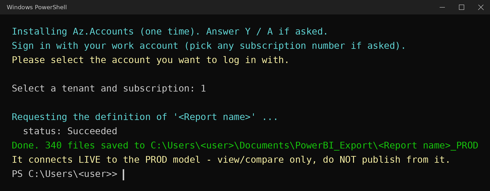

# Power BI Report Exporter (.pbip)

Export any Power BI report from the service as a **Power BI Project (.pbip)** — even when
the *Download this file* option is unavailable — using the Fabric REST API
[`Get Report Definition`](https://learn.microsoft.com/en-us/rest/api/fabric/report/items/get-report-definition).

## Why

- Download is often disabled for reports published to the service, or for thin
  (live-connected) reports.
- Git integration is frequently enabled only for the Development workspace, so the
  versions deployed to Test / Production are not in source control.
- Comparing environments (DEV vs UAT vs PROD) needs the actual deployed definitions.

This script pulls the deployed definition (pages, visuals, bookmarks, filters) straight
from any workspace you have write access to and saves it as a `.pbip` you can open in
Power BI Desktop, diff, or commit.

## Prerequisites

Check these before running the script. The workspace role is the one people most often miss.

### 1. Workspace role on the workspace that holds the report

The API requires **read and write** permission on the report, so you need one of these roles on that workspace:

| Workspace role | Can export? |
|---|---|
| Admin | ✅ Yes |
| Member | ✅ Yes |
| Contributor | ✅ Yes |
| Viewer | ❌ No (returns 403 Forbidden) |
| Report shared with you directly / via an app, no workspace role | ❌ No |
| Build permission on the semantic model only | ❌ No |

Check your role: open the workspace in app.powerbi.com → **Manage access**.

> If the report is live-connected to a semantic model in a different workspace, you only
> need the role on the **report's** workspace, not the model's.

### 2. Licence

- A Power BI licence that lets you access the workspace: **Pro** or **Premium Per User**,
  or a free licence if the workspace is on Premium / Fabric capacity.

### 3. Organisation (tenant) settings

- Your organisation must allow access to the Power BI / Fabric REST APIs. If every call
  returns 403 even though you are Admin/Member/Contributor, ask your Power BI / Fabric
  administrator.
- If the report carries a sensitivity label with **encryption**, you need rights to remove
  that label (configured in Microsoft Purview).

### 4. Your machine

- **Windows PowerShell 5.1** (built into Windows 10/11) or **PowerShell 7+**.
- **Sign-in method**, either:
  - the `Az.Accounts` PowerShell module. The script installs it for your user only
    (no admin rights needed), but it needs internet access to the PowerShell Gallery;
    **or**
  - a browser session on app.powerbi.com, using `-UseBrowserToken` (no module needed).
- **Power BI Desktop**, a recent version, to open the exported `.pbip`. On older versions,
  enable *File → Options → Preview features → Power BI Project (.pbip) save option* and
  the *enhanced report format (PBIR)* option.

### 5. What you need to know about the report

- The **workspace ID** and **report ID**, from the report URL:
  `https://app.powerbi.com/groups/<WorkspaceId>/reports/<ReportId>/...`

## Usage

Find the IDs in the report URL:
`https://app.powerbi.com/groups/<WorkspaceId>/reports/<ReportId>/...`

```powershell
# Sign in with Az.Accounts
powershell -ExecutionPolicy Bypass -File .\Export-PbiReport.ps1 -WorkspaceId "<workspace-guid>" -ReportId "<report-guid>" -Label PROD

# Or use a token from the browser (F12 > Console > copy(powerBIAccessToken))
powershell -ExecutionPolicy Bypass -File .\Export-PbiReport.ps1 -WorkspaceId "<workspace-guid>" -ReportId "<report-guid>" -UseBrowserToken
```

Output: `Documents\PowerBI_Export\<Report name>_<Label>\<Report name>_<Label>.pbip`

> Run the script as a **file**. Pasting it line by line into the console breaks the
> `if / else` blocks.


## Troubleshooting

| Error | Meaning |
|---|---|
| 401 Unauthorized | Token missing or expired — sign in again or use `-UseBrowserToken` |
| 403 Forbidden | No write access on the workspace, or Fabric APIs disabled by the tenant admin |
| 404 Not Found | Wrong workspace or report ID |
| Desktop cannot open the .pbip | Update Power BI Desktop / enable the PBIP and PBIR preview features |

## Notes

- Read-only: the script never changes anything in the workspace.
- The exported report stays live-connected to its semantic model. Be careful not to
  publish from the exported copy unless you intend to overwrite the original.
- Reports with an encryption sensitivity label require rights to remove that label.
- `-UseBrowserToken` relies on a value exposed by the Power BI web page; it is a
  convenience, not an official Microsoft API. Treat the token like a password.

## License

MIT
